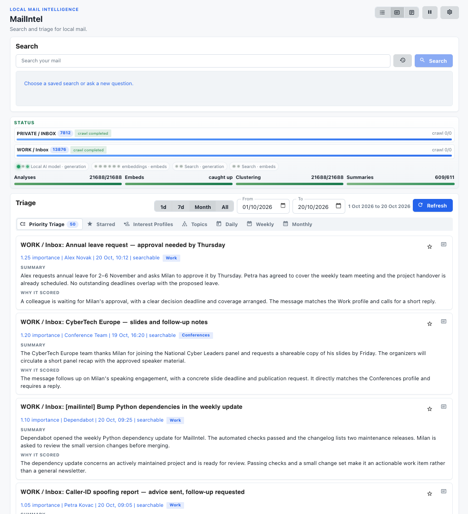

<!--
SPDX-FileCopyrightText: Milan Pikula
SPDX-License-Identifier: EUPL-1.2
-->

# MailIntel

MailIntel is a self-hosted application for secure AI-assisted email analysis, prioritization, and search, built around read-only mailbox access and controlled processing.

Many people use agentic AI to process their e-mail. That is very risky:

- Emails contain untrusted text. An attacker can write a message that tries to persuade an AI agent to follow instructions hidden inside it.
- An agent with mailbox permissions can send messages, delete correspondence, or change settings following a mistaken interpretation.
- Access to tools, credentials, and external services can turn a misleading email into a route for leaking sensitive information.
- Processing mail through a cloud model sends its contents to another organization.

MailIntel limits these risks through its architecture. Its connectors read email while preserving the mailbox. Models receive content for specific analysis tasks, while mailbox credentials stay with the application’s connectors. Their outputs become summaries, classifications, and answers stored in the application database.

You choose the model provider. You can use cloud-based frontier models, accepting that the email content submitted for processing is shared with their provider. Or you can use a small local model of your choice that fits in just a few gigabytes of memory, keeping inference within your own infrastructure.

You review the results and their source messages, then decide what action to take.

The central principle is to **keep AI mistakes confined to analysis**. A mistaken summary or a manipulated response has no authority to send, delete, or modify your mail. The model provides interpretations; control over your correspondence stays with you.

The public project lives at [github.com/milankowww/mailintel](https://github.com/milankowww/mailintel).



*Priority Triage with illustrative correspondence. [Browse all screenshots](doc/screenshots/README.md) or follow the [illustrated user guide](doc/user-guide.md).*

## Quick start

You need Docker with Compose, access to an IMAP or Exchange EWS mailbox, and a reachable model service providing text generation and embeddings. Get the source and start the application:

```sh
git clone https://github.com/milankowww/mailintel.git
cd mailintel
cp .env.example .env
# Edit .env and replace POSTGRES_PASSWORD with a unique password.
docker compose --project-directory . -f deploy/compose/docker-compose.yml up -d --build
docker compose --project-directory . -f deploy/compose/docker-compose.yml exec app mailintel auth token
```

Open **http://127.0.0.1:8000** and enter the printed token. Keep it private: it grants access to your mail and settings.

1. In **LLM Settings**, configure and enable your model preset, check connectivity, and select the text and embedding models your provider serves.
2. In **Mail Settings**, add an account, choose its mailboxes, and start sync. Gmail has a dedicated [Google OAuth setup](doc/google-oauth.md).
3. Set your role, priorities, and interest profiles in **Triage Settings**. As processing finishes, explore the dashboard, topics, and search.

The first build downloads dependencies. The database persists under `docker-data/postgres/` and encryption keys in the `mailintel_secrets` Docker volume; restarting containers preserves them. The app listens on localhost; PostgreSQL is accessible within the Compose network.

## Learn more

- [Installation](doc/installation.md): model connectivity, local Python, and development setup.
- [User guide](doc/user-guide.md): accounts, triage, topics, stars, search, and processing controls.
- [Operations](doc/operations.md): settings, backups, authentication, and troubleshooting.
- [Documentation index](doc/README.md): API and architecture references.
- [Contributing](CONTRIBUTING.md): tests, database development, and source packages.
- [Support](SUPPORT.md) and [security reporting](SECURITY.md): where to ask for help.
- [Releases](doc/releases.md): building, validating, and upgrading releases.

MailIntel runs one application instance with its background workers. It is designed for a private installation with a shared bearer token granting access to the whole application.

## Contributors

MailIntel welcomes code, documentation, testing, and reproducible bug reports, including small improvements. Git history records accepted code and documentation contributions; release acknowledgements also recognize other help with contributors’ consent. See the [contribution credit policy](CONTRIBUTING.md#contribution-credit).

## Author and license

MailIntel was created by Milan Pikula.

MailIntel is licensed under the [European Union Public Licence v. 1.2](LICENSE). The license text is reproduced unchanged from the [European Commission’s official download](https://interoperable-europe.ec.europa.eu/sites/default/files/inline-files/EUPL%20v1_2%20EN%281%29.txt).
